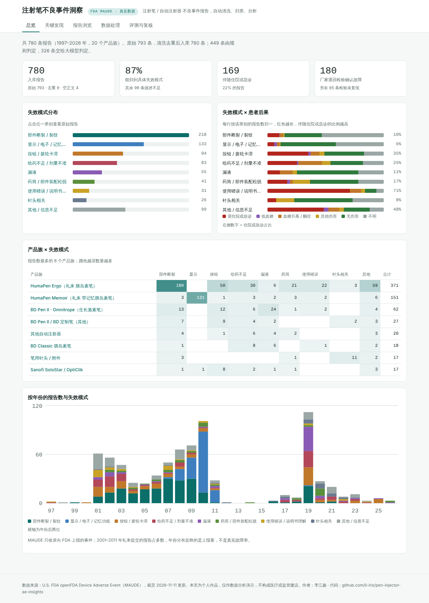

# pen-injector-ae-insights：注射笔不良事件洞察

个人项目，用的是 FDA 公开的真实数据。

> **一句话**：把 FDA 公开的 793 条注射笔 / 自动注射器不良事件报告（英文、非结构化、写法混乱），用「规则 + 大模型」两层自动清洗、归类，产出可追溯到原文的失效模式分析，作为注射器研发的设计输入。



## 解决什么问题

注射器企业做上市后监测、竞品分析和风险管理（ISO 14971）时，都要读大量不良事件报告。FDA MAUDE 数据库是公开的，但很难直接用：

- 正文是患者、药师、厂家客服写的自由文本，大段模板话术，关键信息埋在中间；
- 同一家厂商有 7 种写法，同一款笔有几十种写法（颜色、规格、拼写错误）；
- FDA 的结构化「问题代码」很粗，经常和正文对不上。

人工一条条读，几百条要几天。这个项目把它变成一条可重复跑的流水线，并且每个结论都能点回原始报告。

## 亮点

- **真实数据，真实问题**：openFDA 接口导出的 793 条报告，覆盖礼来、BD、赛诺菲、诺和诺德、艾伯维、安进等厂商的 20 个产品族。
- **规则 + 大模型分层，按成本分工**：规则能确定的直接用（449 条，零成本、可解释）；规则拿不准的才交给大模型（326 条）。不是所有数据都扔给大模型。
- **两层互相校验**：从规则高置信样本里抽 85 条再让大模型判一遍，一致率 80%；分歧样本优先人工复核，人工结果作为金标。
- **结论能落到设计上**：6 条关键发现，每条都给出设计输入建议。例如：
  - 一款生长激素笔开裂，厂家查明是**笔袋里的增塑剂与聚碳酸酯发生作用**，说明包材也要做相容性验证；
  - 「按不动」投诉 35% 伴随住院或急诊，但退回检验**按压力符合规格**，说明规格应按老人、手部力量弱的人群来定，高粘度药液会让问题更严重；
  - 使用错误类只有 31 条，但 **71% 住院或急诊**，是后果最重的一类，防错设计要优先于培训。
- **可私有化部署**：大模型层走 OpenAI 兼容接口，可以直接换成本地 Ollama / vLLM 部署的 Qwen，数据不出内网。

**技术栈**：Python · openFDA API · 正则 / 规则引擎 · 大模型结构化抽取（Qwen via Ollama / vLLM，或云端模型）· 原生 JS 前端 · unittest

## 流水线

```
00 fetch.py        openFDA 分页拉取（无需 API key），压缩成每行一条报告
01 clean.py        厂家名归一（63 种写法 → 11 家）、品牌归并（185 种写法 → 20 个产品族）
                   剥离模板话术 1281 句、去重 9 条、空正文 4 条、隐私检查
02 taxonomy.py     规则层：9 类失效模式的关键词 + FDA 问题代码交叉核对 → 高置信直接采用
   llm_extract.py  大模型层：只处理规则拿不准的；先挑与器械相关的关键句再送模型，输出失效模式 / 部件 / 中文摘要
03 analyze.py      合并两层；补充患者后果、厂家调查结论；计算洞察指标和两层一致率
web/               前端：总览、关键发现、报告浏览（原文 + 证据高亮）、数据处理、评测与人工复核
```

## 评测

| 指标 | 结果 |
|---|---|
| 规则层直接判定 | 449 / 780 |
| 交给大模型 | 326 / 780 |
| 规则 vs 大模型一致率（85 条抽样） | 80% |
| 能归到具体失效模式 | 87%（其余描述不足） |

分歧样本暴露的问题（都已修复，见测试）：

1. 规则把 `MISSING SEGMENTS`（显示屏缺笔段）当成「部件缺失」；
2. 隐私脱敏最初用「8 位以上数字」识别电话，误伤了 MDR 报告编号和日期；
3. 给大模型的输入只截前 300 字，关键信息在后面的报告被判成「信息不足」，改为按关键词给句子打分后挑选。

人工复核在演示页面的「报告浏览」里完成，结果实时汇总到「评测与复核」页。

## 局限

- MAUDE 有漏报、重复报和描述不全，**只能看问题类型和信号，不能算故障率**；
- 样本约 2/3 是 2001–2011 年礼来 HumaPen 系列，外推到其他产品要谨慎；
- 仓库里 `data/llm/llm_labels.json` 由 Claude 按 `ae/llm_extract.py` 中同一份提示词生成，用于演示；换成本地 Qwen 重跑即可对比两者差异。

## 运行

```bash
pip install -r requirements.txt
python -m ae.fetch          # 可选：重新拉取最新数据（仓库已附 data/raw）
python -m ae.clean
python -m ae.llm_extract    # 需要 LLM_BASE_URL / LLM_MODEL，例：Ollama + qwen2.5:7b
python -m ae.analyze
python -m unittest discover -s tests -t .
cd web && python -m http.server 8000   # 打开 http://localhost:8000
```

数据来源：U.S. FDA openFDA Device Adverse Event（MAUDE）。本项目仅作数据分析演示，不构成医疗或监管建议。
